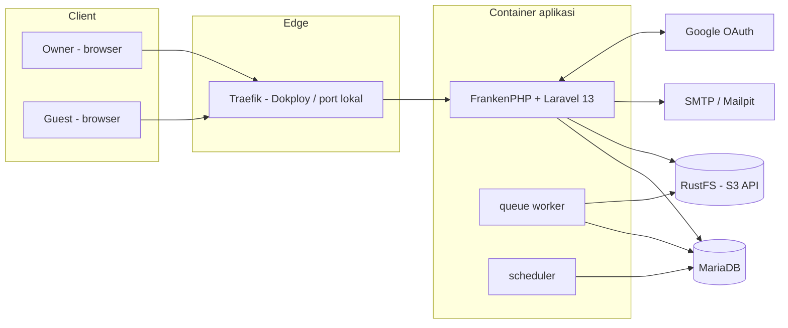
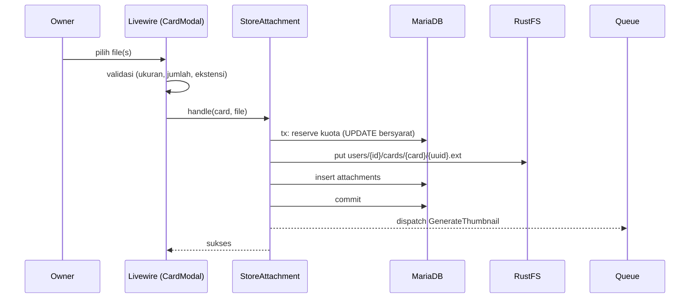
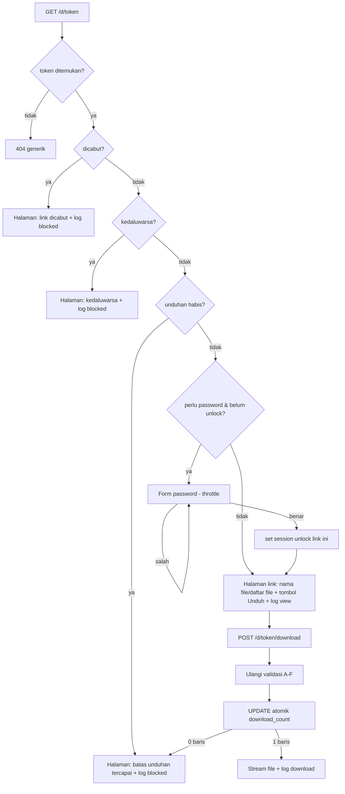

# DropDeck — Architecture

Dokumen ini menjelaskan arsitektur teknis DropDeck: komponen, alur data, struktur kode, keamanan, container, dan deployment (Podman lokal dan Dokploy produksi). Pasangannya: `01-PRD.md`, `03-DATABASE-SCHEMA.md`, `04-RULES.md`.

> **Catatan verifikasi.** Beberapa detail pihak ketiga (tag image PHP 8.5 FrankenPHP, variabel environment RustFS, format template Dokploy, nama command Octane) bisa berubah antar versi. Bagian yang perlu dicek ditandai **[VERIFIKASI]**; daftar lengkap ada di `README.md`.

---

## 1. Gambaran Sistem



Prinsip utama:
1. **Monolit Laravel** dengan Livewire; tidak ada API terpisah atau SPA.
2. **Stateless app**: session, cache, dan queue di MariaDB; file di RustFS. Container app bisa diganti kapan saja.
3. **Browser tidak pernah bicara langsung ke RustFS.** Semua upload/unduh melewati aplikasi sehingga otorisasi dan penghitungan selalu terjadi di satu tempat.
4. **Satu image, tiga peran**: `app` (web), `queue`, `scheduler` memakai image yang sama dengan command berbeda.

## 2. Stack Teknologi

| Lapisan | Pilihan | Catatan |
|:---|:---|:---|
| Runtime | PHP 8.5 pada FrankenPHP | Mode klasik (Caddy `php_server`); mode worker/Octane opsional |
| Framework | Laravel 13 | Livewire starter kit, Fortify |
| UI | Livewire + Flux UI + Tailwind CSS + Alpine.js | Alpine sudah dibundel Livewire |
| Drag-drop | `wire:sort` native Livewire 4 | Tanpa dependency tambahan; lihat bagian 7.2 |
| Auth | Fortify (email) + Socialite (Google) | |
| Database | MariaDB 11.x | Driver Laravel `mariadb` |
| Object storage | RustFS (S3-compatible) via Flysystem S3 | `league/flysystem-aws-s3-v3` |
| Gambar | `intervention/image` v3 (GD atau Imagick) | Thumbnail |
| PDF thumbnail | Imagick + Ghostscript | Opsional lewat feature flag |
| Queue/Cache/Session | Driver `database` | Redis bisa ditambah nanti |
| Email | SMTP (Mailpit di lokal) | Verifikasi dan reset password |
| Test | Pest | |
| Kualitas | Laravel Pint, Larastan | |
| Container | Podman + `podman compose` | Kompatibel Docker |
| Deploy | Dokploy (Docker Compose service) | Traefik sebagai reverse proxy |

## 3. Arsitektur Aplikasi (Layering)

```
HTTP / Livewire request
        │
        ▼
 Livewire Component / Controller      ← tipis: validasi input, panggil Action, render
        │  (Form Object untuk validasi)
        ▼
 Action / Service (app/Actions, app/Services)   ← logika bisnis, transaksi DB
        │
        ├─► Model + Policy (Eloquent)           ← akses data + otorisasi
        ├─► Storage (disk "vault")              ← RustFS
        └─► Job (queue)                         ← thumbnail, hapus objek, cleanup
```

Aturan lapisan ringkas (rinci di `04-RULES.md`):
- Komponen Livewire **tidak** memegang logika bisnis berat; panggil Action.
- Otorisasi **selalu** lewat Policy (`$this->authorize()`), bukan pengecekan manual tersebar.
- Operasi yang mengubah kuota, hitungan unduhan, atau banyak baris dilakukan dalam **transaksi** di Action.

### 3.1 Struktur Direktori (tambahan di atas starter kit)

```
app/
  Actions/
    Boards/        CreateBoard, DeleteBoard
    Cards/         CreateCard, MoveCard, DeleteCard
    Columns/       CreateColumn, MoveColumn, DeleteColumn
    Vault/         StoreAttachment, DeleteAttachment, ReserveQuota
    DropLinks/     CreateDropLink, RevokeDropLink, ResolveDropLink,
                   RegisterDownload, VerifyDropLinkPassword
  Enums/           DropLinkTarget, DropLinkStatus, AccessEvent, ThumbnailStatus
  Http/
    Controllers/
      Auth/GoogleController.php
      AttachmentController.php          (download/thumbnail milik sendiri)
      PublicDropLinkController.php      (show, unlock, download)
    Middleware/    SecurityHeaders, NoIndex
  Jobs/            GenerateThumbnail, DeleteStoredObjects,
                   PruneExpiredDropLinks, PruneAccessLogs, ReconcileStorageUsage
  Livewire/
    Boards/        Index, Show (kanban), Column, Card, CardModal, LabelManager
    Links/         Index, CreateModal
    Dashboard/     Overview, StorageMeter, ActivityLog
    Public/        DropLinkPage (opsional bila UI publik memakai Livewire)
  Models/          User, Board, BoardColumn, Card, Label, ChecklistItem,
                   Attachment, DropLink, DropLinkAccess
  Policies/        BoardPolicy, CardPolicy, AttachmentPolicy, DropLinkPolicy
  Support/         Position (helper urutan), FileGuard (cek ekstensi/mime), Bytes
config/
  dropdeck.php     seluruh batas bisnis
  filesystems.php  disk "vault"
resources/views/   livewire/*, public/droplink/*
lang/id/           terjemahan UI
tests/
  Feature/ Unit/ (Pest)
```

## 4. Penyimpanan File (RustFS)

### 4.1 Bucket dan disk
- Satu bucket privat: `dropdeck` (nama dari env `AWS_BUCKET`).
- Disk Laravel khusus bernama **`vault`** (driver `s3`, `visibility=private`, `throw=true`, `use_path_style_endpoint=true`).
- Aplikasi memakai kredensial service account dengan akses hanya ke bucket ini. Kredensial root RustFS tidak dipakai aplikasi di produksi.

### 4.2 Tata letak object key
```
users/{user_id}/cards/{card_id}/{uuid}.{ext}        # file asli
users/{user_id}/cards/{card_id}/thumbs/{uuid}.webp  # thumbnail
```
- `{uuid}` dibuat server (bukan nama asli) agar tidak ada path traversal atau tabrakan.
- Nama asli hanya di kolom `attachments.original_name`.
- Pemisahan per user memudahkan penghapusan akun (hapus prefix `users/{id}/`).

### 4.3 Keamanan penyimpanan
- Bucket tidak publik; tidak ada URL RustFS yang diberikan ke browser.
- Unduh/pratinjau dilayani aplikasi dengan `StreamedResponse` dari `Storage::disk('vault')->readStream()`.
- Header unduhan: `Content-Disposition: attachment`, `X-Content-Type-Options: nosniff`, `Cache-Control: private, no-store`. Tipe MIME yang dikirim berasal dari daftar aman, bukan input user.
- Enkripsi at-rest: **tidak diklaim** di MVP. Bila diperlukan, aktifkan server-side encryption di RustFS **[VERIFIKASI dukungan]** atau enkripsi di aplikasi (fase 2). Pemisahan akses dijamin oleh path + otorisasi, bukan enkripsi.

### 4.4 Lifecycle objek
| Peristiwa | Aksi |
|:---|:---|
| Upload sukses | Simpan objek → insert `attachments` + tambah `storage_used` (satu transaksi; bila DB gagal, hapus objek) |
| Hapus lampiran | Transaksi: hapus baris + kurangi `storage_used`; setelah commit dispatch `DeleteStoredObjects` |
| Hapus kartu/board | Kumpulkan key lampiran → hapus baris (cascade) → kurangi kuota → dispatch `DeleteStoredObjects` |
| Hapus akun | Dispatch `DeleteStoredObjects` untuk prefix `users/{id}/` setelah baris dihapus |
| Rekonsiliasi (harian) | `ReconcileStorageUsage` membandingkan `SUM(size_bytes)` dengan `storage_used` dan memperbaiki selisih; log objek yatim |

`DeleteStoredObjects` harus **idempotent** (menghapus objek yang tidak ada bukan error) dan `tries=5` dengan backoff.

## 5. Alur Utama

### 5.1 Upload lampiran

- Reserve kuota memakai query atomik: `UPDATE users SET storage_used_bytes = storage_used_bytes + :n WHERE id = :id AND storage_used_bytes + :n <= storage_quota_bytes`. `rows affected = 0` berarti kuota penuh.
- Jika `put` ke RustFS gagal, transaksi di-rollback sehingga kuota kembali.
- Upload melewati PHP pada MVP. Livewire menyimpan file sementara; `php.ini` dan Caddy harus mengizinkan ukuran file maksimum. Fase 2: presigned multipart langsung ke RustFS (butuh CORS dan endpoint publik).

### 5.2 Drag-and-drop kartu
1. Alpine mengirim event ke Livewire: `moveCard(cardId, toColumnId, beforeCardId|null, afterCardId|null)`.
2. Action `MoveCard` memverifikasi kepemilikan (Policy), menghitung posisi baru di antara tetangga (`Position::between`), dan menulis satu baris.
3. Jika jarak posisi < 2, lakukan **rebalance** kolom (renumber dengan gap 1024) dalam transaksi.
4. UI memakai optimistic update; kegagalan memicu refresh state dan toast error.

### 5.3 Membuat DropLink
1. Owner memilih file atau kartu → modal: kedaluwarsa, batas unduhan, password.
2. `CreateDropLink` memeriksa kepemilikan target, batas link aktif, dan rentang nilai.
3. Token: `Str::random(40)` (alfanumerik, ~238 bit entropi); password di-hash (`Hash::make`).
4. Link dibentuk `APP_URL/d/{token}` dan ditampilkan dengan tombol salin.

### 5.4 Akses publik DropLink

Detail penting:
- **GET tidak pernah menaikkan `download_count`.** Crawler preview (WhatsApp, Telegram, Slack) hanya melakukan GET.
- **Unduh = POST** dari tombol eksplisit (dilindungi CSRF). Validasi diulang di tahap unduh (jangan percaya state halaman).
- Penghitungan atomik:
  ```sql
  UPDATE droplinks
     SET download_count = download_count + 1, last_accessed_at = NOW()
   WHERE id = :id
     AND revoked_at IS NULL
     AND expires_at > NOW()
     AND (max_downloads IS NULL OR download_count < max_downloads);
  ```
  Hanya jika `affected rows = 1` file di-stream.
- Jika streaming gagal di tengah jalan, hitungan tetap terpakai (trade-off yang diterima MVP; didokumentasikan di UI: "unduhan dihitung saat dimulai"). Range request tidak didukung di MVP.
- Link kartu: halaman menampilkan judul kartu + daftar file; tiap file diunduh lewat `POST /d/{token}/download/{attachment}`; `attachment` harus milik kartu tersebut.
- Respons publik selalu berisi header `X-Robots-Tag: noindex, nofollow` dan `Referrer-Policy: no-referrer`.

## 6. Keamanan

### 6.1 Otorisasi dan isolasi
- Semua model milik user dicakup lewat relasi/`user_id` dan **Policy**. Route model binding untuk resource privat selalu di-scope (`->scopeBindings()`, atau query `where user_id`).
- Respons untuk resource milik orang lain: **404** (bukan 403) agar tidak membocorkan keberadaan.
- Tes isolasi wajib untuk setiap endpoint privat (Pest dataset dua user).

### 6.2 Autentikasi
- Fortify: hashing bcrypt/argon (default Laravel), throttle login, verifikasi email, 2FA.
- Google (Socialite): validasi `state` otomatis oleh Socialite; terima hanya jika email Google terverifikasi; tautkan ke akun lama berdasarkan email; jangan membuat akun duplikat; sesi dibuat dengan regenerate.
- Konfirmasi password (`password.confirm`) sebelum hapus akun.

### 6.3 Rate limiting
| Endpoint | Batas (default) | Kunci |
|:---|:---|:---|
| Login/2FA | Bawaan Fortify | email+IP |
| Verifikasi password DropLink | 5 / menit, lockout 10 menit setelah 10 gagal | IP + token |
| Halaman/unduh publik | 60 / menit (halaman), 20 / menit (unduh) | IP |
| Upload | 30 / menit | user |
| Buat DropLink | 30 / menit | user |

Didefinisikan di `AppServiceProvider` lewat `RateLimiter::for()`.

### 6.4 Header dan transport
- Middleware `SecurityHeaders`: `X-Content-Type-Options: nosniff`, `X-Frame-Options: DENY` (atau CSP `frame-ancestors 'none'`), `Referrer-Policy: strict-origin-when-cross-origin` (publik: `no-referrer`), `Permissions-Policy` minimal, dan **CSP** yang kompatibel dengan Livewire/Flux (uji; mulai dengan `Content-Security-Policy-Report-Only`).
- HTTPS diakhiri di Traefik (Dokploy). Aplikasi mempercayai proxy: `TrustProxies` dengan `X-Forwarded-*` dari jaringan internal; `APP_URL` bertipe `https` di produksi; cookie `secure`, `same_site=lax`, `http_only`.
- Di lokal berjalan HTTP biasa.

### 6.5 File upload
- Validasi sisi server: ukuran, jumlah, ekstensi terlarang, dan deteksi MIME dari konten (bukan hanya klien).
- Nama file asli disanitasi untuk tampilan dan header `Content-Disposition` (gunakan `filename*=UTF-8''...`).
- File **tidak pernah dieksekusi atau dilayani sebagai HTML/SVG**. Pratinjau hanya untuk thumbnail hasil render (WebP) yang dibuat server.
- Pemrosesan gambar/PDF dibatasi (batas dimensi, memory, timeout) di dalam job.

### 6.6 Data dan privasi
- Log akses menyimpan IP dan user agent dengan retensi (default 90 hari), dijalankan oleh `PruneAccessLogs`.
- Token DropLink tidak dicatat di log aplikasi; hindari token pada query string.
- Secrets hanya di environment/secret manager Dokploy, tidak pernah di repo.

## 7. Frontend

### 7.1 Komponen UI
- Gunakan komponen **Flux UI** sebagai default (button, modal, input, dropdown, badge, toast). Tailwind untuk layout.
- Dark mode mengikuti Flux (appearance settings sudah ada di starter kit).
- Bahasa Indonesia via `lang/id`.

### 7.2 Kanban
- Satu komponen SFC `pages::boards.show` (`resources/views/pages/boards/⚡show.blade.php`) memuat kolom dan kartu, eager loading `cards.labels` plus `withCount(['attachments', 'checklistItems', 'checklistItems as completed_checklist_items_count'])` agar tanpa N+1.
- Drag-drop memakai **`wire:sort` native Livewire 4** (tanpa `@alpinejs/sort`/SortableJS): `wire:sort` + `wire:sort:item` pada daftar kolom, `wire:sort:group="cards"` + `wire:sort:group-id="{columnId}"` untuk pindah kartu antar kolom, `wire:sort:handle` pada header kolom, `wire:sort:ignore` pada kontainer kartu agar klik kartu tetap membuka modal.
- `wire:key` unik pada setiap kolom dan kartu.
- Modal kartu memuat detail (deskripsi, label, checklist, lampiran) secara lazy.

## 8. Konfigurasi

### 8.1 Environment (ringkas)
| Variabel | Contoh lokal | Catatan |
|:---|:---|:---|
| `APP_NAME` | `DropDeck` | |
| `APP_ENV` / `APP_DEBUG` | `local` / `true` | Produksi: `production` / `false` |
| `APP_URL` | `http://localhost:8000` | Produksi: `https://domain` |
| `APP_KEY` | `php artisan key:generate` | Wajib, rahasia |
| `APP_LOCALE` | `id` | |
| `DB_CONNECTION` | `mariadb` | |
| `DB_HOST` / `DB_PORT` | `mariadb` / `3306` | Nama service compose |
| `DB_DATABASE` / `DB_USERNAME` / `DB_PASSWORD` | `dropdeck` / `dropdeck` / rahasia | |
| `SESSION_DRIVER` / `CACHE_STORE` / `QUEUE_CONNECTION` | `database` | |
| `FILESYSTEM_DISK` | `vault` | Disk default untuk lampiran |
| `AWS_ACCESS_KEY_ID` / `AWS_SECRET_ACCESS_KEY` | dari RustFS | |
| `AWS_DEFAULT_REGION` | `us-east-1` | Nilai bebas, wajib ada |
| `AWS_BUCKET` | `dropdeck` | |
| `AWS_ENDPOINT` | `http://rustfs:9000` | |
| `AWS_USE_PATH_STYLE_ENDPOINT` | `true` | |
| `GOOGLE_CLIENT_ID` / `GOOGLE_CLIENT_SECRET` | dari Google Cloud | |
| `GOOGLE_REDIRECT_URI` | `${APP_URL}/auth/google/callback` | Harus terdaftar di Google Console |
| `MAIL_*` | Mailpit lokal / SMTP produksi | |
| `DROPDECK_*` | lihat PRD bagian 7 | |
| `THUMBNAIL_PDF_ENABLED` | `false` | Aktifkan setelah Ghostscript/policy siap |

### 8.2 Google OAuth
- Buat OAuth Client (Web). Authorized redirect URI: lokal `http://localhost:8000/auth/google/callback`, produksi `https://<domain>/auth/google/callback`.
- Scope minimal: `openid email profile`.

## 9. Topologi Container

### 9.1 Layanan (lokal)
| Service | Image | Port host | Fungsi |
|:---|:---|:---|:---|
| `app` | build dari `Containerfile` (target `dev`) | 8000 | FrankenPHP melayani Laravel |
| `queue` | image sama | – | `php artisan queue:work` |
| `scheduler` | image sama | – | `php artisan schedule:work` |
| `vite` | `node:22-alpine` | 5173 | HMR dev |
| `mariadb` | `mariadb:11` | 127.0.0.1:3306 | Database |
| `phpmyadmin` | `phpmyadmin:5` | 8080 | UI database (**dev saja**) |
| `rustfs` | `rustfs/rustfs` | 9000 (S3), 9001 (console) | Object storage |
| `rustfs-init` | `amazon/aws-cli` | – | Membuat bucket sekali jalan |
| `mailpit` | `axllent/mailpit` | 8025 (UI), 1025 (SMTP) | Email dev |

Letak file: root proyek berisi `compose.yaml` (dev), `compose.prod.yaml` (produksi/Dokploy), `.dockerignore`, `.env.example.snippet`; folder `infra/` berisi `Containerfile`, `Caddyfile`, `php.ini`, `docker-entrypoint.sh`; folder `dokploy/` berisi draft template.

### 9.2 Containerfile (multi-stage)
```
base   → FrankenPHP + ekstensi PHP + Ghostscript + konfigurasi
dev    → base + composer + user non-root (untuk bind-mount)
vendor → composer install --no-dev (cache layer)
assets → node build (butuh vendor untuk flux.css)
prod   → base + kode + vendor + public/build, user non-root, healthcheck
```

### 9.3 Catatan Podman
- Rootless Podman: root di dalam container dipetakan ke user host, jadi file hasil container di bind mount tetap dimiliki user Anda. Bind mount memakai `:Z` pada sistem SELinux. Gunakan `userns_mode: keep-id` hanya bila container dijalankan sebagai user non-root.
- Gunakan nama image lengkap (`docker.io/...`) agar tidak ditanya registry.
- Jalankan `podman compose` (memakai `podman-compose` atau `docker-compose` sebagai provider).
- Port < 1024 tidak dipakai (rootless).
- Healthcheck `healthcheck` didukung; `depends_on: condition: service_healthy` bergantung versi provider (jika tidak berjalan, entrypoint menunggu DB sendiri).

## 10. Deployment Produksi (Dokploy)

### 10.1 Pendekatan
- Buat **Compose service** di Dokploy dari repositori; gunakan `infra/compose.prod.yaml`.
- Tidak ada `ports:` ke host. Domain dipetakan di Dokploy (Traefik) ke service `app` port `8000`; TLS (Let's Encrypt) otomatis.
- Variabel environment diisi di tab *Environment* Dokploy (bukan file di repo).
- Volume bernama untuk data: MariaDB dan RustFS.
- Service `queue` dan `scheduler` memakai image yang sama.
- Hanya service `app` yang menjalankan migrasi (`RUN_MIGRATIONS=true`).
- **phpMyAdmin tidak ada di produksi.** Untuk akses DB gunakan terminal Dokploy atau tunnel sementara.

### 10.2 Template Dokploy
Folder `dokploy/` berisi **draft** `template.toml` dan catatan. Dokploy Templates pada dasarnya `docker-compose.yml` + `template.toml` (variabel, domain, env, mount). **[VERIFIKASI]** format terbaru di repositori Dokploy Templates sebelum mengajukan/memakai.

### 10.3 Urutan deploy pertama
1. Siapkan domain dan DNS → server Dokploy.
2. Buat OAuth Google untuk domain produksi.
3. Buat Compose service, isi environment (lihat 8.1), set domain ke `app:8000`.
4. Deploy. Entrypoint menjalankan `migrate --force` dan cache config.
5. Buka RustFS console (jangan diekspos publik; akses lewat tunnel/jaringan privat), pastikan bucket `dropdeck` ada dan buat service account khusus aplikasi, lalu perbarui env.
6. Uji: daftar, upload, buat DropLink, unduh sebagai guest, kirim email.

### 10.4 Backup dan pemulihan
| Data | Metode | Frekuensi |
|:---|:---|:---|
| MariaDB | `mariadb-dump --single-transaction` ke file + salin keluar server | Harian |
| RustFS | Salin volume data atau `aws s3 sync` ke lokasi lain | Harian/mingguan |
| Konfigurasi | Environment Dokploy didokumentasikan (tanpa nilai rahasia) | Setiap perubahan |
Uji pemulihan minimal sekali sebelum demo.

### 10.5 Observabilitas
- Log Laravel ke `stderr` (`LOG_CHANNEL=stderr`) agar tampil di log Dokploy.
- `/up` untuk healthcheck.
- Pantau `failed_jobs`; tambah Horizon/Sentry sebagai fase 2.

## 11. Scheduler dan Job

| Nama | Jenis | Jadwal | Fungsi |
|:---|:---|:---|:---|
| `GenerateThumbnail` | Job | Saat upload | Buat thumbnail WebP; update `thumbnail_status` |
| `DeleteStoredObjects` | Job | Saat hapus | Hapus objek/prefix dari RustFS (idempotent) |
| `PruneExpiredDropLinks` | Schedule | Harian | Hapus record link yang mati > retensi |
| `PruneAccessLogs` | Schedule | Harian | Hapus log akses > retensi |
| `ReconcileStorageUsage` | Schedule | Harian | Koreksi `storage_used`, laporkan objek yatim |
| `queue:prune-failed` | Schedule | Mingguan | Bersihkan failed_jobs lama |
| `model:prune` / `cache:prune-stale-tags` | Schedule | Harian | Sesuai kebutuhan |

Tabel `sessions`, `cache`, dan `jobs` dibersihkan oleh mekanisme bawaan Laravel (lottery session, `queue:work`).

## 12. Strategi Pengujian

| Level | Alat | Fokus |
|:---|:---|:---|
| Unit | Pest | `Position::between`, `Bytes`, `FileGuard`, hitungan status link |
| Feature | Pest + Livewire testing | CRUD, policy isolasi, kuota, DropLink (semua cabang 5.4), Google callback (Socialite mock) |
| Konkurensi | Pest (beberapa proses/transaksi) | Unduhan paralel pada `max_downloads` |
| Storage | `Storage::fake('vault')` | Alur upload/hapus tanpa RustFS |
| Integrasi | `podman compose` lokal | Upload ke RustFS nyata (smoke test manual/skrip) |
| Statis | Pint, Larastan | Dijalankan sebelum merge |

## 13. Keputusan Arsitektur (ADR ringkas)

| # | Keputusan | Alasan | Alternatif |
|:--|:---|:---|:---|
| 1 | Monolit Laravel + Livewire | Cepat, cocok solo dev, UI reaktif tanpa SPA | SPA Vue + API (lebih berat) |
| 2 | Fortify + Socialite | Tanpa vendor lock-in; sudah ada di starter kit | WorkOS (eksternal) |
| 3 | Unduh/upload via aplikasi | Otorisasi, hitungan, dan log terpusat | Presigned URL (fase 2) |
| 4 | Penghitungan atomik di SQL | Aman dari race tanpa lock aplikasi | Redis lock |
| 5 | Unduh dengan POST | Tahan terhadap bot preview | GET dengan token sekali pakai |
| 6 | Mode klasik FrankenPHP | Hindari kebocoran state; sederhana | Octane worker (fase 2) |
| 7 | Driver database untuk queue/cache/session | Satu dependensi lebih sedikit | Redis |
| 8 | Hard delete + job pembersih | Kuota dan storage konsisten | Soft delete (rumit untuk kuota) |
| 9 | Posisi integer bergap | Satu baris per pemindahan | Urut ulang semua baris |
| 10 | Satu tier Free | Sesuai scope; kuota di config | Plan Free/Pro simulasi (dihapus) |

## 14. Pengembangan Lanjutan
Presigned multipart upload, Octane worker mode, Redis + Horizon, ClamAV, enkripsi at-rest, tombol lapor penyalahgunaan, perpanjang link, export PDF, template board, kolaborasi tim.
