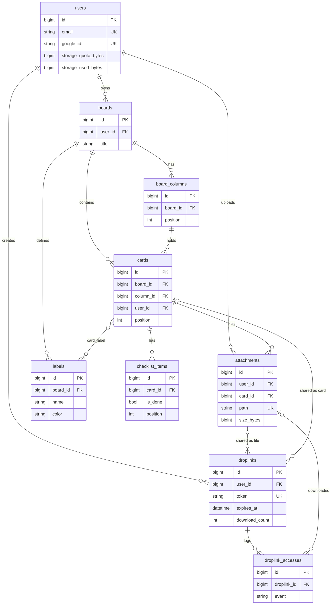

# DropDeck — Database Schema

**DBMS:** MariaDB 11.x (driver Laravel `mariadb`) · **Engine:** InnoDB · **Charset:** `utf8mb4` / `utf8mb4_unicode_ci`
**Konvensi:** nama tabel jamak `snake_case`, PK `id` (`bigint unsigned` auto-increment), FK `{singular}_id`, timestamp `created_at`/`updated_at` kecuali dinyatakan lain, waktu disimpan UTC.

---

## 1. ERD



## 2. Ringkasan Tabel

| Tabel | Sumber | Fungsi |
|:---|:---|:---|
| `users` | Starter kit + modifikasi | Akun, Google ID, kuota storage |
| `password_reset_tokens` | Laravel | Reset password |
| `sessions` | Laravel | Session (driver database) |
| `cache`, `cache_locks` | Laravel | Cache (driver database) |
| `jobs`, `job_batches`, `failed_jobs` | Laravel | Queue |
| `boards` | Baru | Papan Kanban |
| `board_columns` | Baru | Kolom pada board |
| `cards` | Baru | Kartu |
| `labels` | Baru | Label berwarna per board |
| `card_label` | Baru | Pivot kartu–label |
| `checklist_items` | Baru | Checklist kartu |
| `attachments` | Baru | Metadata file di RustFS |
| `droplinks` | Baru | Link publik berbatas |
| `droplink_accesses` | Baru | Activity log akses link |

> Tabel `users`, `password_reset_tokens`, `sessions`, `cache`, `jobs` dibuat oleh migrasi bawaan starter kit. Jalankan `php artisan make:session-table`/`make:cache-table`/`make:queue-table` bila belum ada (Laravel 13 umumnya sudah menyertakannya). Cek migrasi starter kit sebelum menambah migrasi sendiri.

---

## 3. Detail Tabel

### 3.1 `users` (modifikasi tabel bawaan)

Kolom bawaan starter kit (id, name, email, email_verified_at, password, remember_token, kolom two-factor Fortify, timestamps) dipertahankan. Perubahan/penambahan:

| Kolom | Tipe | Null | Default | Keterangan |
|:---|:---|:---|:---|:---|
| `password` | varchar(255) | **YA** (ubah) | NULL | Akun Google-only belum punya password |
| `google_id` | varchar(64) | YA | NULL | `sub` dari Google; **UNIQUE** |
| `avatar_url` | varchar(512) | YA | NULL | Opsional dari Google |
| `storage_quota_bytes` | bigint unsigned | TIDAK | dari config saat dibuat | Kuota per user (default 2 GB) |
| `storage_used_bytes` | bigint unsigned | TIDAK | 0 | Pemakaian; dijaga konsisten oleh Action |

Indeks: `UNIQUE(email)`, `UNIQUE(google_id)`.
Catatan: `email` tetap UNIQUE; penautan Google didasarkan pada email terverifikasi.

### 3.2 `boards`

| Kolom | Tipe | Null | Default | Keterangan |
|:---|:---|:---|:---|:---|
| `id` | bigint unsigned PK | | | |
| `user_id` | bigint unsigned FK → users.id | TIDAK | | `ON DELETE CASCADE` |
| `title` | varchar(120) | TIDAK | | |
| `description` | text | YA | NULL | |
| `color` | char(7) | YA | NULL | Hex `#RRGGBB` |
| `archived_at` | timestamp | YA | NULL | Arsip (NULL = aktif) |
| `created_at`, `updated_at` | timestamp | YA | | |

Indeks: `INDEX(user_id, archived_at)`.

### 3.3 `board_columns`

| Kolom | Tipe | Null | Default | Keterangan |
|:---|:---|:---|:---|:---|
| `id` | bigint unsigned PK | | | |
| `board_id` | bigint unsigned FK → boards.id | TIDAK | | `ON DELETE CASCADE` |
| `title` | varchar(80) | TIDAK | | |
| `position` | int unsigned | TIDAK | | Urutan; gap 1024 |
| `created_at`, `updated_at` | timestamp | YA | | |

Indeks: `INDEX(board_id, position)`.

### 3.4 `cards`

| Kolom | Tipe | Null | Default | Keterangan |
|:---|:---|:---|:---|:---|
| `id` | bigint unsigned PK | | | |
| `user_id` | bigint unsigned FK → users.id | TIDAK | | Pemilik (= pemilik board); denormalisasi untuk scoping cepat; `CASCADE` |
| `board_id` | bigint unsigned FK → boards.id | TIDAK | | `CASCADE` |
| `column_id` | bigint unsigned FK → board_columns.id | TIDAK | | `CASCADE` |
| `title` | varchar(200) | TIDAK | | |
| `description` | text | YA | NULL | Teks biasa (tampilkan ter-escape) |
| `position` | int unsigned | TIDAK | | Urutan dalam kolom; gap 1024 |
| `created_at`, `updated_at` | timestamp | YA | | |

Indeks: `INDEX(column_id, position)`, `INDEX(board_id)`, `INDEX(user_id)`, opsional `FULLTEXT(title)` untuk pencarian (P1).
Aturan integritas (di Action, diuji): `column.board_id = card.board_id` dan `board.user_id = card.user_id`.

### 3.5 `labels` dan `card_label`

**`labels`**

| Kolom | Tipe | Null | Keterangan |
|:---|:---|:---|:---|
| `id` | bigint unsigned PK | | |
| `board_id` | FK → boards.id | TIDAK | `CASCADE` |
| `name` | varchar(40) | TIDAK | |
| `color` | char(7) | TIDAK | Hex |
| `created_at`, `updated_at` | timestamp | YA | |

Indeks: `UNIQUE(board_id, name)`.

**`card_label`** (pivot, tanpa timestamp)

| Kolom | Tipe | Keterangan |
|:---|:---|:---|
| `card_id` | FK → cards.id | `CASCADE` |
| `label_id` | FK → labels.id | `CASCADE` |

PK: `(card_id, label_id)`; `INDEX(label_id)`.
Aturan: label dan kartu harus berada pada board yang sama (divalidasi di Action).

### 3.6 `checklist_items`

| Kolom | Tipe | Null | Default | Keterangan |
|:---|:---|:---|:---|:---|
| `id` | bigint unsigned PK | | | |
| `card_id` | FK → cards.id | TIDAK | | `CASCADE` |
| `content` | varchar(200) | TIDAK | | |
| `is_done` | boolean | TIDAK | 0 | |
| `position` | int unsigned | TIDAK | | |
| `created_at`, `updated_at` | timestamp | YA | | |

Indeks: `INDEX(card_id, position)`.

### 3.7 `attachments`

| Kolom | Tipe | Null | Default | Keterangan |
|:---|:---|:---|:---|:---|
| `id` | bigint unsigned PK | | | |
| `user_id` | FK → users.id | TIDAK | | Pemilik; `CASCADE` |
| `card_id` | FK → cards.id | TIDAK | | `CASCADE` |
| `disk` | varchar(32) | TIDAK | `vault` | Nama disk Laravel |
| `path` | varchar(512) | TIDAK | | Object key; **UNIQUE** (`users/{uid}/cards/{cid}/{uuid}.{ext}`) |
| `original_name` | varchar(255) | TIDAK | | Nama asli (tampilan saja; disanitasi) |
| `extension` | varchar(16) | YA | NULL | Huruf kecil |
| `mime_type` | varchar(127) | TIDAK | | Hasil deteksi server |
| `size_bytes` | bigint unsigned | TIDAK | | Dasar perhitungan kuota |
| `checksum_sha256` | char(64) | YA | NULL | Opsional (integritas/deduplikasi di masa depan) |
| `thumbnail_path` | varchar(512) | YA | NULL | Key thumbnail WebP |
| `thumbnail_status` | varchar(16) | TIDAK | `none` | `none`, `pending`, `ready`, `failed` |
| `created_at`, `updated_at` | timestamp | YA | | |

Indeks: `UNIQUE(path)`, `INDEX(card_id)`, `INDEX(user_id)`.

### 3.8 `droplinks`

| Kolom | Tipe | Null | Default | Keterangan |
|:---|:---|:---|:---|:---|
| `id` | bigint unsigned PK | | | |
| `user_id` | FK → users.id | TIDAK | | Pembuat; `CASCADE` |
| `target_type` | varchar(16) | TIDAK | | `file` atau `card` |
| `attachment_id` | FK → attachments.id | YA | NULL | Terisi bila `file`; `CASCADE` |
| `card_id` | FK → cards.id | YA | NULL | Terisi bila `card`; `CASCADE` |
| `token` | char(40) | TIDAK | | Acak (`Str::random(40)`); **UNIQUE** |
| `label` | varchar(120) | YA | NULL | Nama internal untuk owner |
| `password_hash` | varchar(255) | YA | NULL | Hash password/PIN; NULL = tanpa password |
| `expires_at` | datetime | TIDAK | | Wajib (1 jam – 30 hari) |
| `max_downloads` | smallint unsigned | YA | NULL | NULL = tanpa batas |
| `download_count` | int unsigned | TIDAK | 0 | Hanya naik lewat query atomik |
| `last_accessed_at` | datetime | YA | NULL | |
| `revoked_at` | datetime | YA | NULL | Diisi saat dicabut |
| `created_at`, `updated_at` | timestamp | YA | | |

Indeks: `UNIQUE(token)`, `INDEX(user_id, revoked_at, expires_at)`, `INDEX(attachment_id)`, `INDEX(card_id)`, `INDEX(expires_at)`.

Constraint (dibuat lewat `DB::statement` di migrasi):
```sql
ALTER TABLE droplinks ADD CONSTRAINT chk_droplink_target CHECK (
  (target_type = 'file' AND attachment_id IS NOT NULL AND card_id IS NULL) OR
  (target_type = 'card' AND card_id IS NOT NULL AND attachment_id IS NULL)
);
ALTER TABLE droplinks ADD CONSTRAINT chk_droplink_max CHECK (max_downloads IS NULL OR max_downloads >= 1);
```

**Status turunan** (tidak disimpan; dihitung di model/enum `DropLinkStatus`):
| Status | Kondisi |
|:---|:---|
| `revoked` | `revoked_at IS NOT NULL` |
| `expired` | `expires_at <= now()` |
| `exhausted` | `max_downloads IS NOT NULL AND download_count >= max_downloads` |
| `active` | selain di atas |

Urutan evaluasi: revoked → expired → exhausted → active.

### 3.9 `droplink_accesses` (activity log)

| Kolom | Tipe | Null | Keterangan |
|:---|:---|:---|:---|
| `id` | bigint unsigned PK | | |
| `droplink_id` | FK → droplinks.id | TIDAK | `CASCADE` |
| `attachment_id` | FK → attachments.id | YA | `SET NULL`; file yang diunduh (link kartu) |
| `event` | varchar(24) | TIDAK | `view`, `password_ok`, `password_failed`, `download`, `blocked` |
| `blocked_reason` | varchar(16) | YA | `revoked`, `expired`, `exhausted` bila `event=blocked` |
| `ip_address` | varchar(45) | YA | IPv4/IPv6 |
| `user_agent` | varchar(255) | YA | Dipotong |
| `created_at` | timestamp | TIDAK | Tanpa `updated_at` |

Indeks: `INDEX(droplink_id, created_at)`, `INDEX(created_at)` (untuk pruning).

### 3.10 Tabel Laravel (pastikan ada)

| Tabel | Catatan |
|:---|:---|
| `sessions` | Driver session `database`; kolom `user_id` indeks |
| `cache`, `cache_locks` | Driver cache `database` |
| `jobs`, `job_batches`, `failed_jobs` | Queue `database`; `failed_jobs.uuid` unik |
| `password_reset_tokens` | Email sebagai PK |

---

## 4. Aturan Konsistensi

1. **Kuota:** `users.storage_used_bytes = SUM(attachments.size_bytes)` per user. Dijaga oleh Action pada upload/hapus; diverifikasi harian oleh `ReconcileStorageUsage`.
2. **Reservasi kuota atomik:**
   ```sql
   UPDATE users
      SET storage_used_bytes = storage_used_bytes + :size
    WHERE id = :uid
      AND storage_used_bytes + :size <= storage_quota_bytes;
   -- affected rows = 0  → kuota penuh
   ```
3. **Hitungan unduhan atomik:** lihat `02-ARCHITECTURE.md` bagian 5.4.
4. **Pelepasan kuota saat hapus:** `UPDATE users SET storage_used_bytes = GREATEST(storage_used_bytes - :size, 0) WHERE id = :uid` dalam transaksi yang sama dengan penghapusan baris.
5. **Cascade menghapus baris, bukan objek S3.** Setiap penghapusan yang mengandung lampiran harus mengumpulkan `path` (dan `thumbnail_path`) sebelum delete lalu dispatch `DeleteStoredObjects` **setelah commit** (`DB::afterCommit` / `afterCommit` pada job).
6. **Posisi:** gap awal 1024; sisip di tengah = `floor((a+b)/2)`; jika `b - a < 2` → rebalance seluruh kolom (kolom: kartu; board: kolom) dalam transaksi.
7. **Integritas lintas tabel** yang tidak bisa dibuat FK murni (kolom/board/label harus satu board, link menunjuk target milik pembuat) divalidasi di Action dan dites.
8. **Link target:** `droplinks.user_id` harus sama dengan `user_id` pemilik attachment/kartu.

## 5. Indeks dan Kinerja

| Query umum | Indeks yang dipakai |
|:---|:---|
| Daftar board user | `boards(user_id, archived_at)` |
| Muat kolom board berurutan | `board_columns(board_id, position)` |
| Muat kartu per kolom berurutan | `cards(column_id, position)` |
| Lampiran per kartu | `attachments(card_id)` |
| Buka link publik | `droplinks.token` (UNIQUE) |
| Daftar link milik user | `droplinks(user_id, revoked_at, expires_at)` |
| Log per link terbaru | `droplink_accesses(droplink_id, created_at)` |
| Prune log | `droplink_accesses(created_at)` |
| Prune link mati | `droplinks(expires_at)` |

Eager loading wajib pada halaman board: `columns.cards.labels`, `withCount('attachments')`, `withCount` checklist (total dan selesai).

## 6. Enum (PHP 8.5 backed enums)

```php
enum DropLinkTarget: string { case File = 'file'; case Card = 'card'; }
enum DropLinkStatus: string { case Active='active'; case Expired='expired'; case Exhausted='exhausted'; case Revoked='revoked'; }
enum AccessEvent: string { case View='view'; case PasswordOk='password_ok'; case PasswordFailed='password_failed'; case Download='download'; case Blocked='blocked'; }
enum ThumbnailStatus: string { case None='none'; case Pending='pending'; case Ready='ready'; case Failed='failed'; }
```
Kolom disimpan sebagai `varchar` (bukan `ENUM` DB) agar mudah dimigrasi; casting lewat `$casts`.

## 7. Urutan Migrasi

1. Migrasi bawaan starter kit (users, cache, jobs, sessions, dst).
2. `alter_users_add_dropdeck_columns` (password nullable, google_id, avatar_url, quota, used).
3. `create_boards_table`
4. `create_board_columns_table`
5. `create_cards_table`
6. `create_labels_table` + `create_card_label_table`
7. `create_checklist_items_table`
8. `create_attachments_table`
9. `create_droplinks_table` (+ CHECK constraint)
10. `create_droplink_accesses_table`

Aturan: migrasi bersifat **forward-only** di produksi (jangan edit migrasi yang sudah dideploy); perubahan = migrasi baru.

## 8. Seeder dan Factory

| Item | Isi |
|:---|:---|
| `UserFactory` | Tambah `storage_quota_bytes` dari config, state `googleOnly()` |
| `BoardFactory` / `BoardColumnFactory` / `CardFactory` | Posisi bergap otomatis |
| `AttachmentFactory` | State `withFake()` untuk tes (tanpa objek nyata) |
| `DropLinkFactory` | State `expired()`, `exhausted()`, `revoked()`, `withPassword()` |
| `DemoSeeder` (lokal saja) | 1 user demo, 1 board "Alur Konten" dengan 4 kolom dan beberapa kartu |

## 9. Retensi Data

| Data | Retensi | Mekanisme |
|:---|:---|:---|
| `droplink_accesses` | 90 hari | `PruneAccessLogs` harian |
| `droplinks` mati | 30 hari setelah mati | `PruneExpiredDropLinks` harian (log ikut terhapus via cascade) |
| `failed_jobs` | 14 hari | `queue:prune-failed` |
| Data akun | Sampai akun dihapus | Hapus akun = cascade + hapus prefix storage |

## 10. Contoh Migrasi (referensi)

```php
Schema::create('droplinks', function (Blueprint $table) {
    $table->id();
    $table->foreignId('user_id')->constrained()->cascadeOnDelete();
    $table->string('target_type', 16);
    $table->foreignId('attachment_id')->nullable()->constrained()->cascadeOnDelete();
    $table->foreignId('card_id')->nullable()->constrained()->cascadeOnDelete();
    $table->char('token', 40)->unique();
    $table->string('label', 120)->nullable();
    $table->string('password_hash')->nullable();
    $table->dateTime('expires_at');
    $table->unsignedSmallInteger('max_downloads')->nullable();
    $table->unsignedInteger('download_count')->default(0);
    $table->dateTime('last_accessed_at')->nullable();
    $table->dateTime('revoked_at')->nullable();
    $table->timestamps();

    $table->index(['user_id', 'revoked_at', 'expires_at']);
    $table->index('expires_at');
});

DB::statement("ALTER TABLE droplinks ADD CONSTRAINT chk_droplink_target CHECK (
  (target_type = 'file' AND attachment_id IS NOT NULL AND card_id IS NULL) OR
  (target_type = 'card' AND card_id IS NOT NULL AND attachment_id IS NULL))");
```
